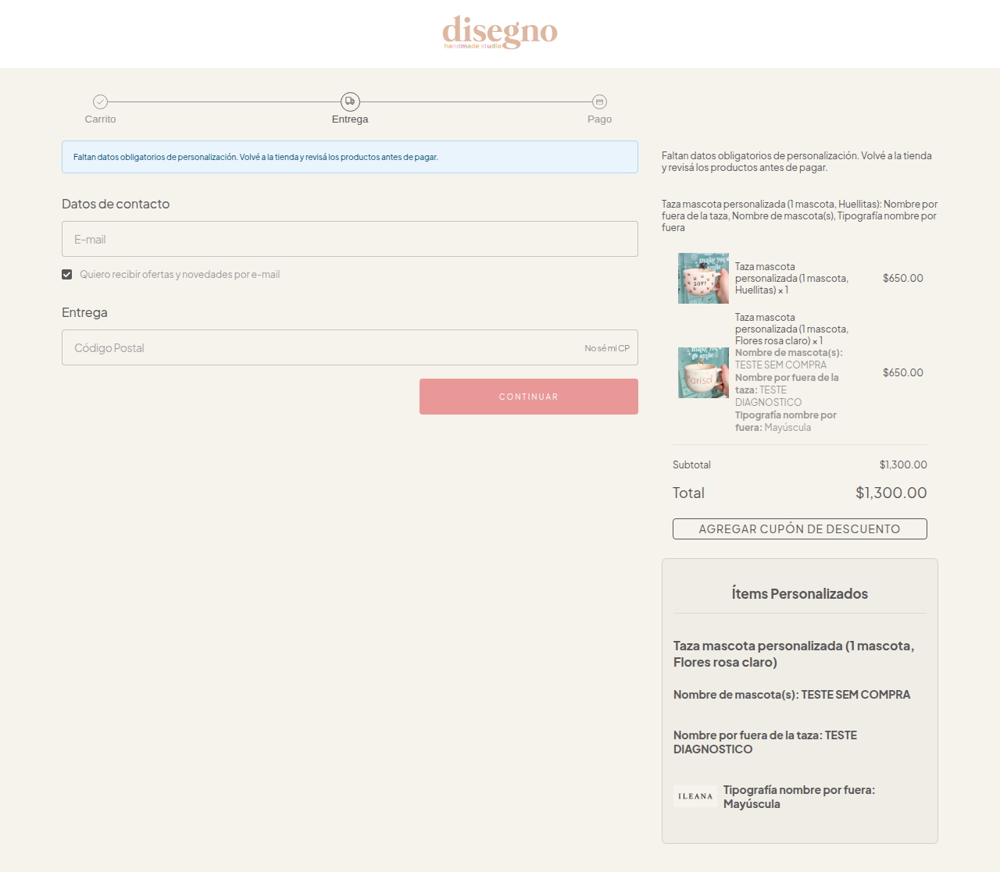
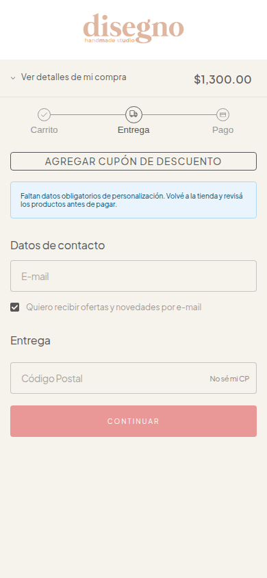

# Disegno.mx — pedido pago sem personalização

Investigação em produção em 30/10/2026 (São Paulo). Datas das consultas e dos logs abaixo em UTC. Loja 5656805, domínio canônico https://disegnomx.com. Nenhum pedido foi finalizado, pagamento realizado, mensagem enviada ou script publicado durante o diagnóstico. Os testes no navegador criaram somente carrinho de diagnóstico com valores fictícios.

## Pedido afetado e recuperação

- Loja sem `uninstalled_at`, plano `PREMIUM`, escopo `read_orders` presente.
- Produto habilitado 335763088, “Taza mascota personalizada”; regra criada em `2026-10-28 22:03:52`.
- Campos obrigatórios: “Nombre por fuera de la taza” (TEXT), “Nombre de mascota(s)” (TEXTAREA), “Tipografía nombre por fuera” (IMAGE_SELECT).
- Pedido mais recente **#147**, ID **2106501570**, criado em `2026-10-30T01:14:16+0000` (29/10 às 22:14:16 em São Paulo), `status=open`, `payment_status=paid`, `storefront=mobile`.
- Item: produto 335763088, variante **1628722081**, “Taza mascota personalizada (1 mascota, Huellitas)”, quantidade 1.
- Listagem e detalhe autenticados do pedido retornam `products[0].properties=[]`. Também retornam `extra={}`, `attributes=[]`, `note=""`, `owner_note=null`. Não há os valores personalizados nessas estruturas.
- O banco em produção não possui armazenamento de rascunhos de compradores. Os campos/configurações e seu histórico guardam definições, não o preenchimento. O SDK publicado guarda o preenchimento em memória do Worker; não envia esses valores para o backend do app. Os logs de diagnóstico também não registram os valores.
- Portanto, não foi possível recuperar os nomes ou a tipografia escolhida. **“Huellitas” é o desenho da variante, não a tipografia.** Não inferir valores a partir da variante ou de outros compradores. A fonte restante é o próprio comprador ou uma conversa já existente com a lojista.

A listagem retorna 48 pedidos; o limite de 50 não explica o problema. Os itens retornados não possuem propriedades preenchidas. O pedido #145, também da caneca, é anterior à criação da regra atual; não tratá-lo automaticamente como outro incidente do app.

## Conexão e relatório

- `store_order_sales`: sem registro da loja. `store_sales_sync`: completo, sem erro, última sincronização `2026-10-30 20:22:40.630258`.
- Logs `list_recent_orders.done`, `response_present=true`: `2026-10-30 23:37:04`, `23:37:53`, `23:41:31` e `2026-10-31 00:05:56`/`00:05:58`.
- `storefront.sdk.rendered` para o produto em `2026-10-30 00:02:47` e `01:03:49`, antes do pedido. Esses eventos não identificam o comprador nem comprovam preenchimento ou envio.
- A tela filtra pedidos com valores reconhecidos nas propriedades. O pedido sem propriedades é excluído por `OrderPersonalization`; não se trata de ausência do pedido na plataforma nem de falha na autenticação atual.

## Reprodução no tema real

A página canônica `/productos/taza-mascota-personalizada-1md24/` identifica Patagonia. A API retorna scripts 7145 (`checkout-v1/8.js`), 9344 (`legado-js/8.js`) e 11470 (`store-front-v5/12.js`) associados e ativos. A página executa somente o SDK da vitrine. **Isso é esperado**, conforme o retorno do suporte já documentado em `docs/diagnostico-patagonia-e-scripts.md`; associar novamente o legado não resolve o incidente.

No navegador com o script publicado:

1. Os três campos aparecem, mas clicar no botão nativo com todos vazios adiciona um item sem propriedades.
2. O app 33395 tem `apps[33395].config.handle_cart_before_update=true`, mas não foi observado `cart:before_update` durante a adição nativa. A flag global é false; ela sozinha não prova o comportamento, pois configurações são mantidas também por app.
3. Enviar `cart:add` explicitamente com as propriedades **persiste os valores**, comprovados ao abrir o checkout. O estado imediatamente retornado do SDK na vitrine chegou a mostrar `properties=[]` apesar da persistência: essa leitura isolada não prova perda.
4. O bundle publicado depende da interceptação nativa para reenviar os dados; não possui uma ação própria de adicionar com personalização nem validação obrigatória no checkout.

Correção da hipótese inicial: o adaptador DOM é histórico e não pode ser importado no Worker. O problema reproduzido é a dependência exclusiva do gate nativo, que não executou nesse tema. Não concluir que `cart:add` descarta propriedades apenas pelo estado transitório do storefront.

## Correção local e validação

- SDK da vitrine: ação própria **Agregar con personalización** no Patagonia, com validação, quantidade própria, variante selecionada, proteção contra cliques duplicados durante o envio e envio direto via `cart:add`.
- Os conflitos existentes de personalização na mesma variante continuam bloqueados.
- SDK do checkout: habilita `has_cart_validation`, verifica os valores efetivamente presentes em cada linha, bloqueia com indicação de produto/campos faltantes. Consulta com falha permanece bloqueada e oferece tentar novamente; não é confundida com produto sem configuração. Respostas antigas não liberam um carrinho mais recente.
- A leitura estrita da configuração usa timeout de 8 segundos e cache curto por produto dentro da sessão.

Os dois bundles foram substituídos **apenas nas requisições da sessão de teste** via Playwright. Nenhuma CDN ou associação remota foi alterada.

Resultados no navegador real:

- Campos vazios no novo botão: três mensagens “Campo obligatorio.”, sem inclusão.
- Preenchimento fictício pelo novo botão: os três valores aparecem no carrinho e no checkout; validação do app `success`.
- Outra variante incluída pelo botão nativo sem preenchimento: checkout retorna `fail`, mostra os três campos faltantes e o botão **Continuar para el pago** tem `disabled=true`.
- Ao remover a linha incompleta, a validação volta a `success`.
- Nenhum dado de contato ou pagamento foi preenchido e nenhuma compra foi concluída. Os itens do carrinho de diagnóstico foram removidos ao final.

Validação automatizada na base isolada da main: 121 testes frontend em 14 arquivos, TypeScript sem erros, build de produção e `git diff --check` aprovados. Backend não foi alterado por esta correção.

## Escopo do backport para main

Somente os scripts do bug, seus testes e esta documentação foram adaptados à main (base 736e6b4). Nenhum commit de funcionalidades da branch de desenvolvimento foi integrado: sem regras por variante, uploads, templates ou homologação local. O reconhecimento da variante nativa do produto já existia na main e continua sendo usado para adicionar o item correto.

O novo erro de limpeza do formulário foi corrigido: uma adição nativa sem envio do app não apaga os valores. Uma confirmação sem propriedades preserva o preenchimento; uma edição feita durante o envio também. A limpeza exige produto, variante, geração do formulário e propriedades confirmadas correspondentes ao envio. Testes permanentes cobrem esses casos e o conflito com uma linha existente no carrinho.

As capturas e os fluxos de navegador acima são da validação anterior com overrides. O backport e a correção da limpeza receberam validação automatizada; precisam da repetição no navegador com os bundles publicados.

## Publicação ainda necessária

A correção ainda não protege as lojas: está no código local e nos bundles gerados. A publicação exige acesso autenticado ao Partner Portal, não disponível nesta sessão de navegador.

1. Publicar primeiro `src/main/frontend/dist/nuvemshop-checkout-sdk.js` como nova versão do script checkout-v1 **7145**, preservando handle, NubeSDK e permissões.
2. Publicar `src/main/frontend/dist/nuvemshop-storefront-sdk.js` como nova versão do script store-front-v5 **11470**, observado nesta loja. Documentos antigos mencionam 9319; conferir o script real no portal e não criar outro ID por engano.
3. Confirmar as novas versões carregadas pela CDN na loja. Repetir os fluxos positivo e negativo no desktop e no celular, com scripts publicados (sem overrides).
4. Confirmar a chegada das propriedades a um pedido em ambiente autorizado para compra de teste. O diagnóstico desta sessão valida até o checkout, não o pedido final pós-publicação.

O botão nativo continua existindo no tema; o bloqueio do checkout é essencial. A solução não depende de conseguir alterar o DOM nativo pelo Worker. O suporte da plataforma deve receber a reprodução do gate ausente; não aguardar esse retorno para preparar a proteção do checkout.

## Texto para a lojista (preparado, não enviado)

> Identificamos la compra #147 de la Taza mascota personalizada, variante “1 mascota, Huellitas”. El pedido está pagado, pero los nombres y la tipografía no quedaron guardados en el pedido. No pudimos recuperar esos valores. Para preparar esta compra, necesitamos confirmar con la persona que compró el nombre exterior, el nombre de su(s) mascota(s) y la tipografía elegida. Ya preparamos y probamos una corrección; aún falta publicarla y verificarla en la tienda.

## Reproducción para soporte de Tiendanube (preparada, no enviada)

> Tienda 5656805, Patagonia, app 33395, storefront SDK 11470 / store-front-v5/12.js, runtime nube-sdk-0.56.0. El app habilita handle_cart_before_update=true, renderiza sus campos y registra el listener al iniciar. Al hacer clic en el botón nativo, no recibimos cart:before_update; el producto se agrega aun con los campos obligatorios vacíos. La ejecución aislada de cart:add con properties sí persiste los valores y estos aparecen en el checkout. Solicitamos verificar la entrega del gate nativo en este tema. Caso afectado: pedido 2106501570 (#147), producto 335763088, variante 1628722081. No incluimos datos personales del comprador.
